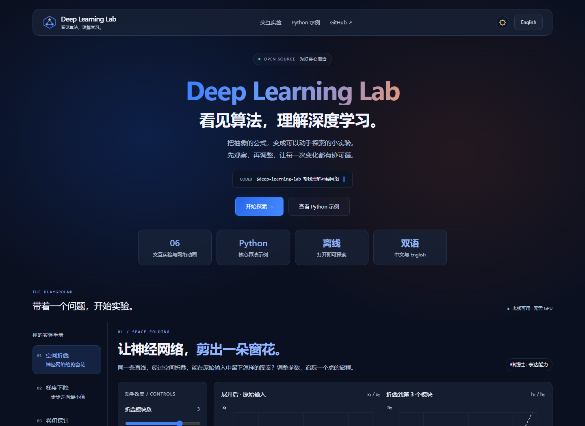

# Deep Learning Lab

**Learn deep learning by changing things.**

[中文](README.md) · [Open the lab](assets/lab/index.html?lang=en) · [Agent Skill](SKILL.md) · [Contribute](CONTRIBUTING.md)

A small, offline collection of bilingual experiments for beginners. Change a parameter, inspect the picture and numbers, and connect what happened to the equation.



## Try it

Download or clone the repository, extract it, and open **`index.html`** in a modern browser. Choose English in the header. No installation, server, GPU, account, API key, or deep learning framework is required. There are no remote scripts, fonts, or analytics. Reference links use the network only when followed.

GitHub's file preview does not execute the lab. Use a downloaded copy, or enable GitHub Pages for online access.

| Experiment | Explore | Understand |
| --- | --- | --- |
| Space folding | Add folding blocks, rotate the input, move the cut, trace a point, disable ReLU | How nonlinearity can create a complex boundary |
| Gradient descent | Step or play; compare four learning rates | Convergence, oscillation, and divergence |
| Convolution | Edit pixels; change the kernel, stride, and padding; inspect nine products | How a feature value and its receptive field are connected |
| CNN | Play through convolution, activation, pooling, and output; inspect shapes and feature maps | How local features become class scores |
| ResNet | Trace the main and skip paths; toggle the skip connection and zero residual | How the input is added to a residual output |
| Transformer | Follow attention and residual blocks; select a query token and toggle causal masking | How a token combines information from other positions |

Start by setting four folding blocks, predicting the effect of disabling ReLU, then trying it. The navy interface uses blue/orange glows and translucent panels, supports Chinese / English, narrow screens, keyboard controls, and a light / dark toggle in the header.

The three network animations support play, pause, stepping, reset, and stage selection. They compute small forward passes with fixed hand-written weights and show actual intermediate values. They are not pretrained models and do not claim recognition accuracy. Convolution settings use themed selection cards and segmented buttons.

## Reproduce the math in Python

The Python learning area follows the selected experiment and displays its core algorithm code for reading and understanding. The page does not execute this code.

The repository also includes standalone Python examples for local study and development. With Python 3.10+, run from the project root:

```sh
python python/deep_learning_lab.py --topic fold
python python/deep_learning_lab.py --topic gradient --learning-rate 1.8
python python/deep_learning_lab.py --topic convolution --kernel blur
```

Read [python/deep_learning_lab.py](python/deep_learning_lab.py). These examples cover the three foundational algorithms, use only the standard library, expose intermediate results, accept `--json` for structured output, and document further options through `--help`. Python snippets beside the network animations illustrate core structure; they are not complete runnable network scripts.

Python provides readable, reproducible algorithm examples. JavaScript runs the browser interactions, preserving offline use and static hosting. Actual cross-language tests compare 330 cases and their intermediate fields. The web page does not execute Python or require a Python server.

For a later step into real model training, see the [official PyTorch basics tutorial](https://docs.pytorch.org/tutorials/beginner/basics/intro.html). PyTorch is not required for this lab.

## Use the Agent Skill

The repository root is a complete skill folder. Following the [official Codex instructions](https://learn.chatgpt.com/docs/build-skills), put it at `~/.agents/skills/deep-learning-lab/` or your project's `.agents/skills/deep-learning-lab/`. A client with another configured skill directory should use that directory. Avoid installing the same named skill twice.

```text
$deep-learning-lab Explain ReLU with an interactive paper-folding experiment.
$deep-learning-lab Help me see why a large learning rate can diverge.
$deep-learning-lab Build a minimal visual explanation of attention weights.
```

Six topics are bundled, including a small attention demonstration in the Transformer animation. Other algorithms use the authoring guidance and need a newly implemented and verified experiment. Running the AI skill needs a compatible agent; browsing the experiments does not.

Export a portable copy with Python 3.10+:

```sh
python scripts/export_lab.py --output ./my-experiment --topic gradient --lang en
```

The destination must not exist. The exported copy includes all six topics and the foundational Python source, with the selected topic and language as its starting state. Topic options are `fold`, `gradient`, `convolution`, `cnn`, `resnet`, and `transformer`.

## Share through GitHub Pages

Commit this folder to your public repository, including `.github/`. In **Settings → Pages → Source**, choose **GitHub Actions**. Manually run **Actions → Publish learning lab → Run workflow**. Share the URL returned by the deployment.

The workflow checks the numerical models, exports the web interface and Python source to `_site/`, and deploys that directory. It runs only when manually triggered; check GitHub Actions for the actual deployment result. See [GitHub's Pages workflow documentation](https://docs.github.com/en/pages/getting-started-with-github-pages/using-custom-workflows-with-github-pages).

## Develop and check

Only maintainers need these tools. The application itself has no runtime dependencies.

```sh
# Node.js 20+ (a supported LTS is recommended)
npm test

# Python 3.10+, standard library only
python -m unittest discover -s tests -p "test_*.py" -v

# Optional browser verification
npm ci
npx playwright install chromium
npm run test:browser
```

Set `DLLAB_BROWSER_CHANNEL=msedge` to use an installed Edge browser. Optionally set `DLLAB_SCREENSHOT_DIR` for screenshots. Browser checks cover interactions, independent numerical expectations, language switching, dark mode, external resource requests, and 320–1440px layouts. Chromium-family browsers are checked; Firefox and Safari have not been verified.

Foundational models are in `assets/lab/core.js`, network forward passes in `assets/lab/network-model.js`, and their interfaces in `assets/lab/app.js` and `assets/lab/networks-ui.js`. See `references/lessons.md` for topic definitions and `references/authoring.md` for extension guidance.

## Scope and license

Folding uses specially constructed residual ReLU blocks; it does not train a network. Gradient descent uses one quadratic objective, so its learning-rate thresholds are specific to that objective. Convolution uses single-channel cross-correlation without bias or activation.

The CNN is a small single-channel construction. The ResNet demo isolates residual addition and omits normalization and the post-add activation. The Transformer is a three-token, single-head block; causal masking illustrates restricted visibility. These preserve the mechanisms without reproducing a full pretrained architecture. References: [ResNet paper](https://arxiv.org/abs/1512.03385), [Transformer paper](https://arxiv.org/abs/1706.03762), and [PyTorch CNN tutorial](https://docs.pytorch.org/tutorials/beginner/blitz/neural_networks_tutorial.html).

All displays share the numerical model. Mechanical checks do not establish educational effectiveness; feedback from beginners is welcome.

Original code, interface, and documentation are [MIT licensed](LICENSE). Linked research and textbooks retain their own rights; their illustrations are not copied here. Contributions and corrections are welcome: [CONTRIBUTING.md](CONTRIBUTING.md).
